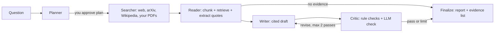

# CiteMesh: free multi-agent research assistant

You type a research question. Five agents plan, search, read, write and fact-check. **Every claim in the report is tied to a verbatim quote from a real source**, and if no evidence is found, no report is written.

Cost: **$0**. Local LLM via Ollama; optional free cloud fallback (Groq / Gemini).

## Quick start (MacBook Air M1, zsh)

```zsh
brew install python@3.12 ollama git        # skip what you already have
ollama serve &                             # or just open the Ollama app
ollama pull llama3.2:3b                    # chat model (~2 GB). 8 GB RAM: keep it at 3-4B
ollama pull nomic-embed-text               # embeddings (~270 MB)

cd citemesh
python3.12 -m venv .venv && source .venv/bin/activate
pip install -r requirements.txt
python -m pytest -q                        # 17 passed = code is healthy (no Ollama needed)

python main.py "How do retrieval-augmented LLMs reduce hallucinations?"
streamlit run app.py                       # web UI
```
Optional on 8 GB: `export OLLAMA_MAX_LOADED_MODELS=1` before `ollama serve` so chat and embedding models never sit in RAM together.

Your own PDFs: drop them in `data/pdfs/`; they are used as sources automatically.

## Free cloud fallback (when local is slow, or when deployed)
```zsh
cp .env.example .env     # add GROQ_API_KEY or GEMINI_API_KEY (free keys, no card)
python main.py --provider groq "your question"
```
Cloud tiers are **not private**; never send sensitive data. Embeddings still use Ollama; if it is absent, retrieval silently falls back to keyword matching (set `use_embeddings: false` to skip the attempt).

## Architecture


| File | Role |
|---|---|
| `citemesh/agents.py` | the 5 agents (one shared LLM, different system prompts) |
| `citemesh/graph.py` | LangGraph wiring, conditional edges, loop guard |
| `citemesh/llm.py` | Ollama/Groq/Gemini switch, retry + backoff, JSON repair |
| `citemesh/knowledge.py` | chunking and retrieval (embeddings or keyword fallback) |
| `citemesh/tools/` | search tools, polite fetcher (robots.txt), PDF loader, SQLite cache |
| `citemesh/report.py` | strips invalid citations, appends references |
| `main.py` / `app.py` | CLI / Streamlit UI |
| `tests/` | 17 tests with a fake LLM and fake tools |

## Why it is more than chained prompts
- **Quote verification:** Reader quotes must appear verbatim in the source or they are rejected (`agents.py`, reader).
- **Critic loop:** rule-based citation checks plus an LLM fact-check, bounded by `max_iterations`.
- **Refusal path:** no evidence means no report.
- **Human approval** of the plan before any searching.
- **Prompt-injection defence:** untrusted text is delimited, known attack phrases are stripped, and agents have no side-effect tools.

## VERIFY before you rely on it (these change often)
- Model names in `config.yaml` (Ollama library, Groq models page, Gemini models page).
- Free-tier rate limits and data policies of Groq/Gemini.
- arXiv API terms (be gentle: results are cached) and `ddgs` stability (DuckDuckGo may rate-limit; failures return empty lists and the run continues with other sources).

## Known limitations (put these in your report)
- Small 3B models write plain reports and sometimes miss evidence; the critic and quote checks catch fabrication but not every weak argument. A bigger model or `--provider groq` improves quality.
- Quote verification is exact-match after whitespace/case normalisation; a correct but slightly reworded quote is rejected (safe but lossy).
- PDF export is not built in: open the `.md` in VS Code ("Markdown PDF" extension) or `brew install pandoc` then `pandoc report.md -o report.pdf` (needs a LaTeX engine; HTML export is simpler).
- No automatic benchmark script yet; see "Next steps".

## Next steps for your internship
1. Write 15-20 benchmark questions, run each with the full graph and with a single-LLM baseline, and compare citation validity, claim support, latency and tokens (`state["stats"]` already gives tokens and seconds).
2. Add a Semantic Scholar / OpenAlex tool in `tools/web.py` (check terms first).
3. Add a SQLite embedding cache for large PDFs.
